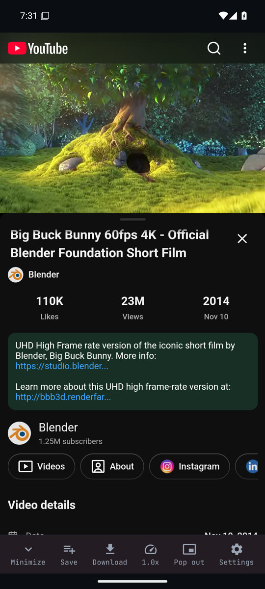
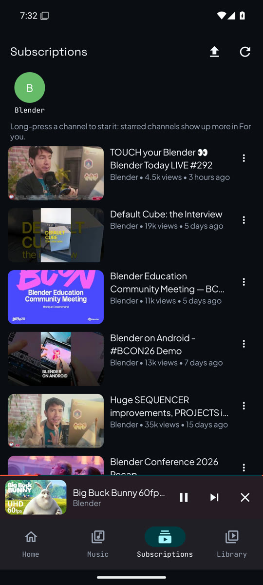
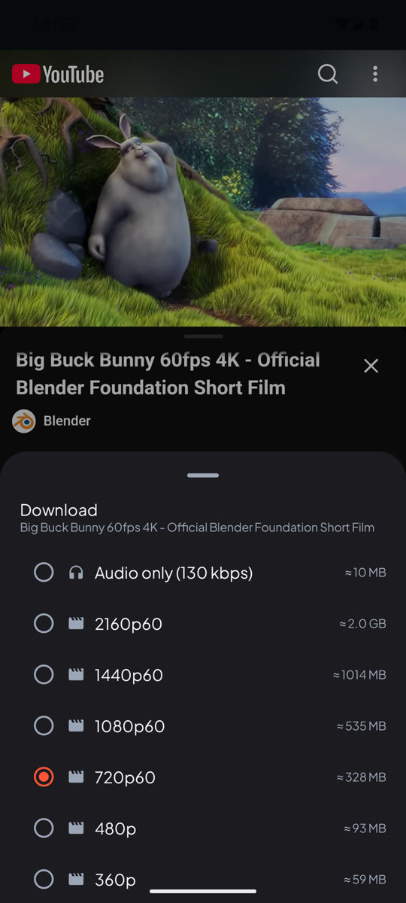
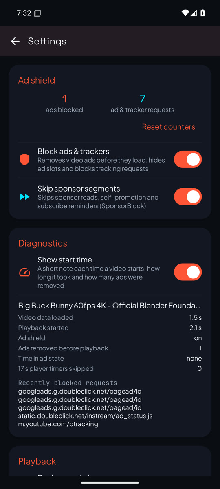

  

<h1 align="center">StreamShield</h1>

  An Android app for watching YouTube and listening to YouTube Music without ads and without a
  Google account, with downloads and a library that stays on your phone.

  <a href="https://github.com/streamshield-app/StreamShield/releases/latest/download/StreamShield.apk"><b>Download the APK</b></a>
  · <a href="https://github.com/streamshield-app/StreamShield/releases">Releases</a>
  · <a href="CHANGELOG.md">Changelog</a>

  
  
  
  

StreamShield shows YouTube's mobile website (`m.youtube.com`) and YouTube Music
(`music.youtube.com`) inside the app, and builds native screens around them: Home, Music,
Subscriptions, Library and Downloads. It is a small personal project, not a Google product, and
it is not on the Play Store.

## Features

**Watching**
- **Ad blocking.** Video ads are removed from YouTube's data before the player reads it; if one
  still starts, it is muted and skipped. Ad slots in feeds are hidden, and requests to known ad
  and tracking hosts are refused. Settings shows what was blocked for the last video.
- **SponsorBlock** skips sponsor reads, self-promotion and subscribe reminders (can be turned off).
- **Background play** with notification, lock-screen and headset controls; **picture-in-picture**;
  fullscreen; playback speed from 0.25× to 3×.
- **Autoplay** keeps going with the screen off and in picture-in-picture. Mixes, playlists and the
  YouTube Music queue always continue; suggested videos follow the Autoplay setting.

**Your library, without an account**
- History with resume, Watch later, Liked videos and your own playlists.
- YouTube's Like and Dislike buttons work in the app: a like goes to Liked videos, a dislike
  shows less of that channel in For you.
- Subscriptions: YouTube's Subscribe buttons subscribe in the app, and you can import your
  subscriptions from Google Takeout. New uploads come from each channel's RSS feed.
- Home → **For you**: fresh uploads from your subscriptions first, then a mix of videos related
  to what you watched in the app, channels you watch often and your recent searches. Each
  pull-down draws a new mix, and more loads as you scroll.
- Home and the Music tab are laid out like the YouTube and YouTube Music apps. Home has tabs
  Home · Subs · Recently uploaded · New to you. The Music tab has mood chips, Speed dial, Quick
  picks (its own For you: songs from YouTube Music's "Up next" for songs you played, related songs
  and new uploads of artists you play often), radios, Forgotten favorites, and YouTube Music's own
  home shelves below. A song plays in YouTube Music, whose radio continues after it.
- Backups: export and import everything as one file, an optional daily backup to a folder you
  choose, and import of your YouTube watch history from Google Takeout.

**Downloads**
- Download a video in a chosen quality, or audio only. Files are saved to `Movies/StreamShield`
  and `Music/StreamShield` and play offline in the app.
- **Smart downloads** (music; 1 GB by default, adjustable or off in Settings): keeps songs you
  listen to plus related ones, refreshed once a day on Wi-Fi while charging. These stay inside the
  app.

## Install

1. On your phone, open the
   [latest APK](https://github.com/streamshield-app/StreamShield/releases/latest/download/StreamShield.apk).
2. Open the downloaded file. Allow "Install unknown apps" for your browser when Android asks. Play
   Protect may warn about an app from outside the Play Store; choose "Install anyway" if you trust
   this source.
3. To update, install a newer APK the same way; your library is kept. The app does not check for
   updates itself; watch the [Releases](https://github.com/streamshield-app/StreamShield/releases)
   page.

Requires Android 7.0 or newer. Picture-in-picture needs Android 8.0 (entering it automatically
when you leave the app, Android 12), and saving downloads to the shared Movies and Music folders
needs Android 10.

Every push to `main` also produces a test build, the pre-release
["StreamShield (latest build)"](https://github.com/streamshield-app/StreamShield/releases/tag/latest).
It can be less stable than a numbered release.

## Privacy

- There is no account and no sign-in. History, subscriptions, playlists, likes and settings are
  stored only on the phone, and leave it only in backups you export.
- The app has no analytics or crash reporting. It connects to:
  - YouTube and Google's video servers, as any browser showing YouTube does (YouTube sees your IP
    address and the videos you watch, but not an account);
  - each subscribed channel's RSS feed on `youtube.com`, to list new uploads;
  - YouTube, through NewPipe Extractor, for downloads, smart downloads and "For you";
  - the SponsorBlock API (`sponsor.ajay.app`), which receives the ID of each video you open, while
    SponsorBlock is on.

## Limitations

- **It depends on YouTube's website.** When YouTube changes its pages or data, ad blocking,
  Subscribe buttons or downloads can stop working until the app is updated.
- **"Confirm you're not a bot."** On some networks (often cloud servers and VPNs) YouTube asks for
  this check; playback and downloads do not work while it does.
- **Nothing is synced to YouTube.** Likes, subscriptions and history stay in the app; your
  YouTube account and its recommendations do not see them.
- **Recommendations are simple.** "For you" and smart downloads only know what you did in the app
  and any history you imported.
- **Videos with a pre-roll ad start a few seconds later.** When YouTube had scheduled an ad, its
  servers hold back the first video data for about 4 s even though the ad is removed; other videos
  start in about a second ([measurements](docs/test-reports/2026-10-24.md)).
- **Terms of service.** Blocking ads and downloading videos may be against YouTube's Terms of
  Service. Download only what you have the right to keep.

## How it works

The YouTube pages run in Android WebViews. A script injected before YouTube's own code
(`app/src/main/assets/shield.js`) removes ads from the data, hides ad slots, keeps playback going
in the background and in picture-in-picture, and reports playback state to the app, which drives
the notification, the mini-player and the library. Requests to ad and tracking hosts are refused
by the app before they leave the phone. Downloads, smart downloads and "For you" use
[NewPipe Extractor](https://github.com/TeamNewPipe/NewPipeExtractor); offline playback uses
Media3 ExoPlayer. The full design is in [ARCHITECTURE.md](ARCHITECTURE.md).

## Contributing and documentation

Issues and pull requests are welcome. Every pull request is built and unit-tested by GitHub
Actions.

- [docs/DEVELOPMENT.md](docs/DEVELOPMENT.md): building, testing, releases and signing.
- [ARCHITECTURE.md](ARCHITECTURE.md): how the app is put together and why.
- [AGENTS.md](AGENTS.md): conventions and pitfalls, for contributors and AI coding agents.
- [docs/LOCAL_TESTING.md](docs/LOCAL_TESTING.md): the Docker dev environment and the on-device
  test plan.
- [CHANGELOG.md](CHANGELOG.md): what changed in each release.

## Credits

- [NewPipe Extractor](https://github.com/TeamNewPipe/NewPipeExtractor) for stream extraction.
- [SponsorBlock](https://sponsor.ajay.app) for crowd-sourced skip segments.
- The screenshots show *Big Buck Bunny* and the Blender channel. *Big Buck Bunny* is
  © Blender Foundation, [CC BY 3.0](https://creativecommons.org/licenses/by/3.0/).

YouTube and YouTube Music are trademarks of Google LLC. StreamShield is not affiliated with or
endorsed by Google.
